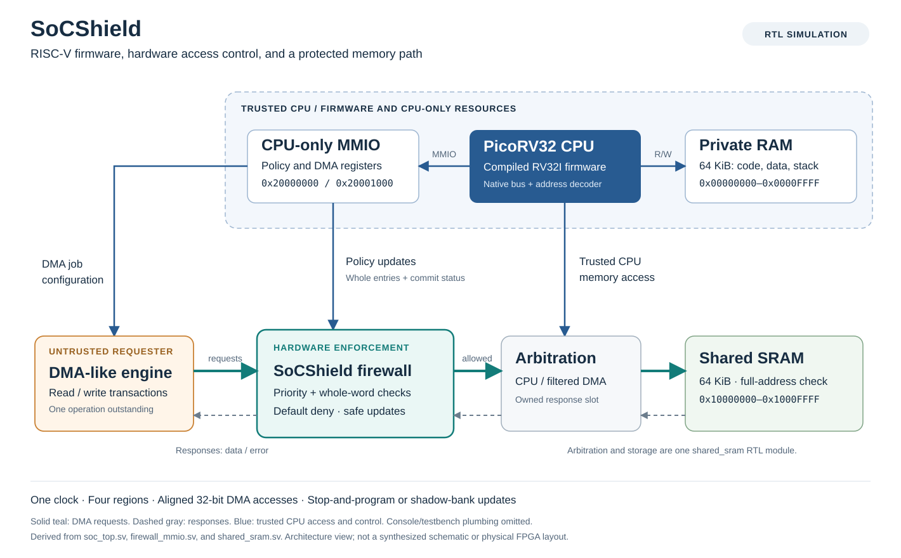

# SoCShield

## Integrated RISC-V system

The project now includes a pinned PicoRV32 CPU executing compiled RV32I firmware, a trusted configuration interface, a DMA-like peripheral, and shared SRAM arbitration. Start with [the integrated results](docs/integration/results.md), [architecture](docs/integration/architecture.md), [reproduction instructions](docs/integration/reproduce.md), and [student walkthrough](docs/integration/student-guide.md).



The overview is an AI-assisted explanatory drawing. [Tool-generated RTL schematics](docs/integration/schematics.md) provide separate, reproducible circuit views exported by Yosys and laid out by Graphviz. Generate them locally with:

```powershell
& .\tools\oss-cad-suite\lib\python3.exe scripts\export_schematics.py --setup
```

From this directory in PowerShell:

```powershell
.\scripts\run_soc.ps1 boot
.\scripts\run_soc.ps1 demo
.\scripts\run_soc.ps1 verify
.\scripts\run_soc.ps1 evaluate
.\scripts\run_soc.ps1 map
```

The required deliverable is RTL simulation with compiled firmware, component verification, and controlled measurements. Technology mapping measures the firewall/control wrapper's library-cell area. Static timing and physical FPGA operation are not established. Dependencies can be fetched and checked with `scripts/setup_soc.py`; the original OSS CAD Suite installation remains required.

### Local simulation dashboard

Launch the browser interface from PowerShell with `.scripts
un_dashboard.ps1`. It runs only on `127.0.0.1`, launches the same compiled-firmware RTL simulation used by the command-line flow, and displays transaction metrics, commit events, simulation output, and an optional VCD waveform. It requires the pinned local OSS CAD Suite and firmware compiler. The interface is a local simulation viewer, not an FPGA control panel. See [dashboard guide](docs/integration/dashboard.md).

## Standalone baseline

A working RTL portfolio study of a hardware firewall on the sole memory path of an untrusted DMA-like peripheral. It enforces four address regions and compares two ways to change permissions safely during traffic. This is established access-control technology; the contribution here is the implementation, verification evidence, and controlled cost comparison.

Start with [the specification](docs/spec.md), [verification scope](docs/verification.md), and [measured findings](docs/results.md). The custom ready/valid interface is not AXI.

## Project

- `rtl/firewall.sv`: static enforcement core.
- `rtl/firewall_update.sv`: common data path with stop-and-program (`SHADOW=0`) or inactive-bank programming (`SHADOW=1`).
- `tb/`: directed tests, persistent-memory scoreboard, and update comparison.
- `formal/`: safety assertions, cover checks, and SymbiYosys jobs.
- `scripts/verify.ps1`: static simulation, proof, bounded checks, covers, and four faulty variants.
- `scripts/compare.ps1`: update simulations, synthesis, proof, covers, and early-drain faulty variants.
- `scripts/render_evidence.py`: independently audits the real VCD handshakes and renders trace excerpts.
- `scripts/package.py`: checks that proof inputs match the distributed source and creates a compact archive with a checksum manifest.
- `build/`: generated logs, traces, metrics, source hashes, and formal status files.

## Reproduce on Windows

The local tools are OSS CAD Suite release **2026-10-29** from the official [YosysHQ release](https://github.com/YosysHQ/oss-cad-suite-build/releases/tag/2026-10-29). Place its extracted `oss-cad-suite` directory under `tools/`, or put equivalent tools on your path. No FPGA toolchain or physical board is required.

From this project directory in PowerShell:

```powershell
.\scripts\verify.ps1
.\scripts\compare.ps1
& .\tools\oss-cad-suite\lib\python3.exe .\scripts\render_evidence.py
```

Both scripts stop on unexpected failures. Negative tests count as successful only when an assertion or simulation failure is observed, rather than a syntax/tool error. Generated faulty RTL stays under `build/`; the real implementation is not modified.

Use `-SkipFormal` for simulation-only runs. Such runs do not establish formal results. Use `-SkipMutations` with `verify.ps1` to omit negative tests. The package excludes the large local tool bundle; it is reproducible from the pinned upstream release.

## Interpretation

Passing assertions establish the properties and assumptions in `docs/verification.md`, not arbitrary system-level security. Synthesis uses generic Yosys cells and gives an area proxy. There is no library-mapped timing, power, physical deployment, or silicon-security result. Progress and finite update time require downstream and requester progress; safety remains meaningful during an indefinite stall.
