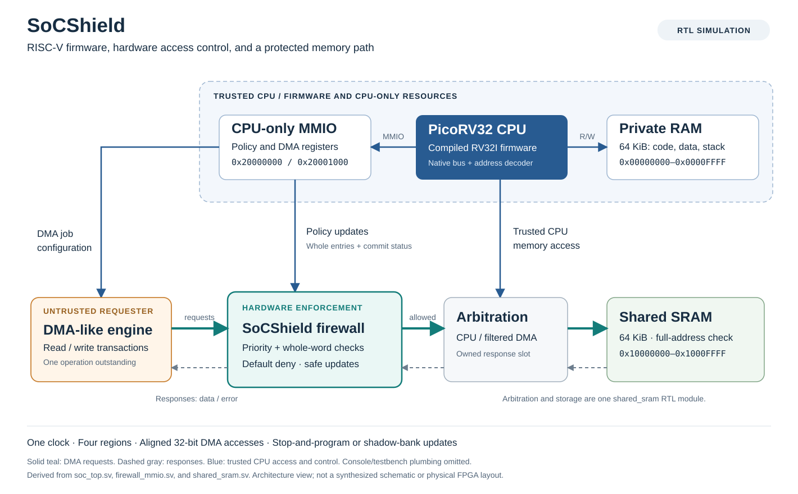

# Integrated SoC architecture and trust boundary

## Purpose and scope

This is a one-clock RTL simulation platform for studying the existing SoCShield firewall and its two update modes. A compiled RV32I firmware image executes on a pinned PicoRV32 instance. The system is not a board implementation, a complete commercial SoC, or a proof that firmware or the CPU is secure. The contribution is the integration, control interface, DMA-like engine, memory path, tests, and comparison. PicoRV32 and the toolchain are reused and attributed in the provenance files.

## Block and access path

This architectural view follows the implemented connections. Arbitration and storage are logical blocks within the same SRAM endpoint module. Arrows summarize access paths; detailed cycle behavior remains in the interface specification. The console and testbench observation/delay wiring are omitted for clarity.

`rtl/soc/soc_top.sv` decodes full CPU addresses. CPU instruction fetches and stack accesses use private RAM. CPU MMIO accesses reach the firewall-control wrapper, DMA staging registers, or simulation log. The DMA engine has no direct route to CPU private RAM or MMIO: its only request path is through `firewall_mmio`/`firewall_update`, then to the shared-SRAM port. The SRAM checks its complete 32-bit address before calculating an index, so truncation cannot turn a forbidden address into a shared-memory alias.

The CPU is trusted; the peripheral is the subject of enforcement. The DMA here is a synthesizable, sequential demonstration engine controlled by firmware, not a free-running adversarial master. It can be staged with a target, word count, operation, and write pattern, but issues one aligned word at a time and waits for each response. The firewall is tested independently against arbitrary changing inputs in its standalone/formal environment. Neither the firewall nor this integration authenticates a compromised CPU or trusted configuration path.

| Address range | Use | Reachability |
|---|---|---|
| `0x00000000–0x0000ffff` | Boot/code/data/stack private RAM | CPU only |
| `0x10000000–0x1000ffff` | Shared SRAM | CPU directly; DMA only through SoCShield |
| `0x20000000–0x20000fff` | Firewall control | CPU only |
| `0x20001000–0x20001fff` | DMA control and result registers | CPU only |
| `0x20002000–0x20002fff` | Simulation console/result and test controls | CPU only |

These constants originate in `config/soc_map.json`. `scripts/generate_map.py` emits `rtl/soc/soc_map.vh` and `firmware/soc_map.h`; `scripts/soc.py` runs that generator before building. Edit the JSON source, not the generated files. The generator currently rejects changes to the RAM geometry until the SRAM and linker assumptions are reviewed. The detailed firewall control map is in [registers.md](registers.md); the DMA map is summarized below and implemented by [`dma_engine.sv`](../../rtl/peripherals/dma_engine.sv).

## Request and response timing

The CPU uses PicoRV32's native memory interface; the project does not claim AXI compatibility. CPU local accesses complete through the decoder. A shared-memory CPU request is latched as accepted once, held in the SRAM protocol until its response, and completes at the CPU only when that response is valid. Reset is coordinated and flushes pending protocol state; SRAM contents need not be cleared by reset.

The shared SRAM accepts at most one operation globally. When both requesters are waiting, the grant preference alternates after each accepted request. The grant owner is retained through the response, and each response is routed only to its owner. A permanently stalled endpoint can prevent progress; fairness is conditional on requests being presented and the endpoint continuing to accept and complete work.

SoCShield selects the lowest-index enabled matching region and checks direction, alignment, and containment of all four bytes. Denials return an error and zero data without forwarding. Allowed DMA requests are forwarded once; downstream memory errors return as errors with sanitized data. A policy commit is considered complete only after old-policy work has drained through its upstream response. It cannot undo writes already accepted by SRAM.

`SHADOW=0` stops request acceptance while it drains and programs its sole bank. `SHADOW=1` allows active-bank traffic while the inactive bank is programmed, then stops acceptance, drains, and switches banks. Both modes share the MMIO contract documented in [registers.md](registers.md). The message path and update state machines are within project RTL; the CPU, compiler, simulator, and SRAM endpoint model are external or modeled components, not new security mechanisms.

## Firmware and DMA result contract

Firmware is built as freestanding RV32I/ILP32 C plus startup assembly and a linker script. `_start` establishes the stack and clears BSS before `main`. The program checks initialized data, BSS, byte/halfword/word stores, then performs default-deny, grant, read/write, protected-sentinel, broad-policy containment, overlapping-revocation, and regrant scenarios. `main.c` contains the compact demonstration driver (`policy`, `command`, `start`, `done`, and `transfer`); [registers.md](registers.md) is the register-level reference.

DMA register accesses are aligned full-word MMIO transfers. A valid `START=1` snapshots the staging registers and clears per-job success/denied counters, read checksum, and sticky error. A zero count completes immediately without issuing a memory request. For nonzero counts, the base must be aligned and the exclusive end `base + 4*count` must not exceed `2^32`; this uses a 35-bit sum. The engine holds a request until accepted and consumes every response. It continues after denial through the configured count. `SUCCESS` counts non-error responses, `DENIED` counts error responses, and `CHECKSUM` XORs data from successful reads in the current job. `ERR` is sticky for rejected MMIO/start accesses or a denied memory response; a write of bit 0 clears it, and a newly accepted start also clears it. `DONE` remains set until the next accepted start. Optional `GAP` inserts the configured number of idle cycles between words.

The console is a simulation register implemented in `soc_top.sv`; it is not a UART, pin-level serial link, or hardware output. The testbench observes console writes and result codes independently.

## Verification boundary and limits

Evidence is split by method. Standalone firewall formal proofs cover the firewall/update modules under their documented one-clock, coordinated-reset assumptions and without fairness assumptions. MMIO-wrapper formal checks replace the backend with an over-approximated interface whose ready/ack/busy signals may behave arbitrarily; they prove wrapper-local safety, not that the real backend acknowledges correctly. The shared-SRAM harness checks arbitration, ownership, address/range behavior, and response stability for a small modeled memory; it does not prove the whole interconnect or CPU. The DMA engine has directed simulation coverage, not an end-to-end formal security proof. End-to-end behavior is checked by RTL simulation of the CPU and firmware with an independent testbench scoreboard.

Simulation delay injection is testbench-only. `--stall` arms a fixed memory stall after firmware starts the designated long transfer; `--random-stalls` enables a seeded endpoint schedule. CPU contention reads are compiled with `--contention 1`. These controls are not hardware features. Solver properties do not model the CPU, firmware correctness, physical SRAM, caches, ECC, power, or physical attacks. Mapping reports are limited to the firewall MMIO wrapper; no static timing analysis, placement, routing, power, FPGA, or silicon measurement is claimed.

See [evidence-matrix.md](evidence-matrix.md) for requirement-to-source/test/proof links and the current evidence state, and [reproduce.md](reproduce.md) for commands and provenance.
