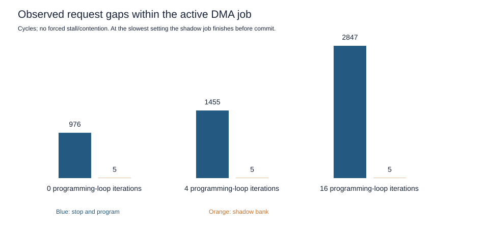
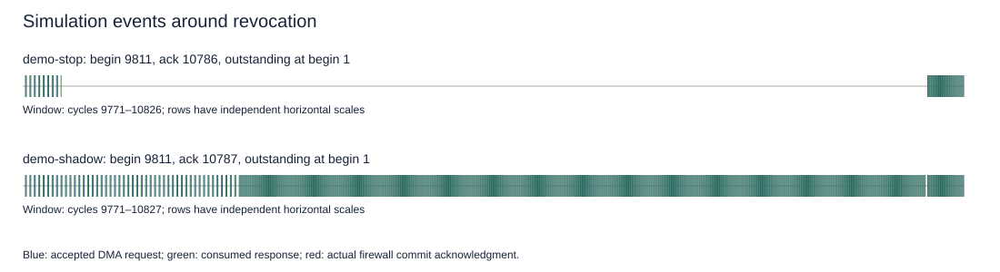

# SoCShield integrated RISC-V system: measured results

The pinned PicoRV32 RTL executes compiled RV32I/ILP32 C firmware. Both SoCShield update variants pass the dedicated security demonstration. The integrated workload matrix contains 24 deterministic cases and 10 seeded endpoint-stall cases; all pass the independent transaction/memory scoreboard. These are simulation results, accompanied by component safety proofs and library-mapped area. No physical FPGA deployment, whole-system formal proof, or static timing result is claimed.

## Demonstration

| Mode | Total simulated cycles | DMA accepted/completed | Error responses | Requests reaching SRAM endpoint | Outstanding operation at update begin |
|---|---:|---:|---:|---:|---:|
| Stop | 18119 | 1067/1067 | 1006 | 64 | 1 |
| Shadow | 17279 | 1067/1067 | 966 | 104 | 1 |

Firmware checks default denial, allowed writes/readback and checksum, denied reads/writes, private/control/high-address alias probes under a deliberately broad policy, revoke during a transfer, and repeated regrant. The bench independently reconstructs policy and memory effects, checks DMA payload/response correctness and CPU SRAM exact-once routing, and compares final SRAM contents. Three broad-policy probes reach the SRAM endpoint and are rejected by its full-address decode; they never reach private RAM or configuration registers. The DMA engine continues through errors, so counts include intentional denied operations.

## Controlled update comparison

| Programming-loop iterations per entry | Stop: begin→ack cycles | Shadow: begin→ack cycles | Stop: active-job acceptance gap | Shadow: active-job acceptance gap |
|---:|---:|---:|---:|---:|
| 0 | 975 | 976 | 976 | 5 |
| 4 | 1454 | 1455 | 1455 | 5 |
| 16 | 2846 | 2847 | 2847 | 5 |

Programming gaps are C loop iterations, not hardware cycles. Begin→ack uses actual firewall handshakes. The active-job gap is independently reconstructed from successive requests in the designated 1,024-word DMA job whose intervals intersect begin→ack; it excludes gaps between separate jobs. At the slowest programming setting, the shadow job can finish before commit, so that row does not measure a switching interruption under sustained demand. Raw `max_acceptance_gap` may include subsequent firmware idle time and is not interchangeable with this metric. `analysis.csv` records both and flags jobs whose requests all precede acknowledgment. `inhibited_cycles` separately counts the controller inhibit condition during the firmware phase. The firmware phase includes MMIO and polling overhead. CPU instruction timing, arbitration, and update phase affect results. The broad sweep records overlap rather than requiring every update to land on a busy cycle; the dedicated demonstrations require overlap.

Acceptance metrics count both allowed and denied operations. Faster error completion is not useful-data throughput, and total demonstration runtime includes firmware overhead and different numbers of old-policy successful operations. These measurements must not be presented as a general application speedup.

The deterministic matrix varies mode (2), programming gap (3), one-shot endpoint stall (0 or 64 cycles), and a firmware shared-memory-access workload (off/on). The latter performs checked reads while DMA is active and between entry updates; it is not a constant-rate background master. `contested_cycles` records actual simultaneous CPU/DMA demand; a configured contention workload does not imply every cycle contends. Five seeds per mode drive additional pseudo-random endpoint stalls. Complete measurements and per-run manifests are in `build/soc/evaluation/summary.csv` and its run directories.

## Verification

The integration verification entry point passed 12 checks: three component simulations, six formal tasks, and three negative controls. The original standalone static/update suites and independent VCD audit were also rerun successfully.

- The original firewall safety proofs retain their documented assumptions and scope.
- Wrapper proofs use an unconstrained backend abstraction. They establish wrapper-local command, payload, counter, and error behavior, not the backend security guarantee.
- The SRAM/arbiter proof uses four words and LATENCY=2 with initial reset; directed simulation tests the production addressing logic and reset retention.
- The CPU executing firmware is tested in end-to-end simulation; it is reused IP and is not re-proved here.
- Early completion reporting, address aliasing, and wrong response ownership are each rejected by semantic test failures. Parse errors or timeouts are not counted as fault detection.

## Library-mapped implementation cost

| Configuration | Mapped cells | Sequential cells | Cell-area sum (µm²) |
|---|---:|---:|---:|
| Stop | 3334 | 590 | 29577.1168 |
| Shadow | 4172 | 861 | 42024.0544 |

The shadow wrapper/firewall has 42.1% higher library-cell area in this mapping. This measures `firewall_mmio` plus `firewall_update`, not the CPU, RAM, DMA engine, or whole chip. It is distinct from the earlier bare-firewall generic-cell comparison.

Mapping uses the pinned SKY130 HD typical 25 °C / 1.8 V Liberty and identical Yosys/ABC settings. Cell area excludes routing, clock tree, floorplan, and other physical overhead. The ABC 5 ns target guides mapping; it is not measured delay or proof of timing closure. See [implementation evidence](implementation.md) for provenance and tool limitations.

## Calculations and interpretation

- Transaction latency = response-consumption cycle − request-acceptance cycle.
- Update latency = actual acknowledgment cycle − accepted begin/commit cycle; the start event must be named.
- Cell-area overhead = (shadow area − stop area) / stop area × 100%.
- DMA throughput in bytes/cycle = successful transferred words × 4 / measured workload cycles. Converting to bytes/second requires an explicitly assumed or validated clock frequency.
- Lower interruption is useful only while preserving the same denial and old-operation completion contract. A permanent stall may prevent commit indefinitely.

## Reproduction and limitations

See [reproduction instructions](reproduce.md), [architecture](architecture.md), [requirements/evidence matrix](evidence-matrix.md), and [student walkthrough](student-guide.md). The required output is a simulated RTL system. No board, power result, physical timing, secure boot, independent reset, cache coherence, standard-bus compliance, or claim of a new security mechanism is included.
