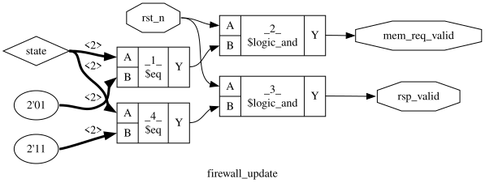

# Generate schematics from the implemented RTL

These views are produced by hardware and graph-layout tools. Yosys reads the real SystemVerilog, resolves `SHADOW=0` or `SHADOW=1`, converts procedural logic to RTLIL cells, optimizes it, checks structure, and emits DOT. Graphviz calculates the layout and renders SVG. The circuit nodes/connections and their positions are not hand-drawn or generated by an image model.

The export scripts were written with AI assistance. That automation is distinct from the circuit extraction and layout, which are performed by Yosys and Graphviz. The colored system overview remains an AI-assisted explanatory diagram; these schematics provide a separately reproducible view of actual RTL.

## Run it yourself

Open PowerShell in `C:\Users\User\Documents\SoCShield`. The existing pinned OSS CAD Suite and Node.js are required. On first use:

```powershell
& .\tools\oss-cad-suite\lib\python3.exe scripts\export_schematics.py --setup
```

Subsequent exports:

```powershell
& .\tools\oss-cad-suite\lib\python3.exe scripts\export_schematics.py
```

`--setup` downloads the pinned `@viz-js/viz` 3.25.0 package, verifies its archive SHA-256, and extracts it locally. That package runs the Graphviz 14.1.3 engine compiled to WebAssembly. The renderer file is also hash-checked. Node performs the HTTPS download; a separate native Graphviz installation is unnecessary. Normal export runs are local and do not upload RTL to a website. See `tools/viz-provenance.json`, the [Viz.js source](https://github.com/mdaines/viz-js), and [Graphviz](https://graphviz.org/).

## Start with a small circuit



This is the selected combinational logic driving `mem_req_valid` and `rsp_valid`. `state` is an input boundary for this view: its flip-flops and next-state logic are deliberately outside this selected cone. The constants are the actual encoded transaction states. This small view is an example for learning to read the export, not a complete firewall schematic.

## Which file to open

| View | Stop-and-program | Shadow bank | What it shows |
|---|---|---|---|
| Small valid-signal example | [SVG](figures/schematics/stop_valids.svg) | [SVG](figures/schematics/shadow_valids.svg) | Memory request-valid and upstream response-valid logic |
| Request/response control | [SVG](figures/schematics/stop_handshakes.svg) | [SVG](figures/schematics/shadow_handshakes.svg) | Selected combinational logic feeding `req_ready`, `mem_req_valid`, and `rsp_valid` |
| Permission decision | [SVG](figures/schematics/stop_access.svg) | [SVG](figures/schematics/shadow_access.svg) | Selected input cone of `allowed`, including comparisons and selection logic |
| Complete firewall module | [SVG](figures/schematics/stop_full.svg) | [SVG](figures/schematics/shadow_full.svg) | Entire optimized `firewall_update` module, including state and policy storage logic |
| Instance boundary | [SVG](figures/schematics/stop_wrapper.svg) | [SVG](figures/schematics/shadow_wrapper.svg) | Actual firewall instance and connected boundary wires inside its MMIO wrapper |

Open the full SVG in a browser and zoom. It is intentionally dense. The scope is the firewall/control boundary, not a full-CPU schematic. Keep it as technical evidence and use smaller views to explain one mechanism at a time.

## Reproduce the individual tool steps

The exact Yosys commands for each mode are saved as `.ys` files under `build/soc/schematics/`. Their essential sequence is:

```text
read_verilog -sv rtl/firewall_update.sv
chparam -set SHADOW 1 firewall_update
hierarchy -check -top firewall_update
proc
opt -full
check -assert
show -format dot -viewer none -enum -width -prefix build/soc/schematics/shadow_full firewall_update
```

The exported `.dot` is the original graph emitted by Yosys. `render_schematic.cjs` passes it unchanged to Graphviz. You can also open the same DOT with a separately installed Graphviz tool; the official [download page](https://graphviz.org/download/) provides Windows packages. Different Graphviz versions/fonts can change layout without changing the circuit graph.

## Read and validate the result

- Octagons identify module ports; diamond shapes identify named internal wires and selection boundaries.
- Cells such as `$eq`, `$ge`, `$le`, `$mux`, and `$logic_and` are word-level RTL operators. Bus labels show widths. They are not technology-specific transistor symbols.
- `_1_`, `_2_`, and similar names are Yosys-generated short identifiers. The logs retain mappings to source identifiers and locations.
- Focused views omit logic outside the selection. A boundary wire does not imply a new physical input or a missing register in the implemented module.
- All ten outputs have source and output hashes in `figures/schematics/manifest.json`. Exact commands, logs, and RTLIL JSON snapshots remain in `build/soc/schematics/`.
- A successful structural check and rendered schematic do not prove functional correctness. Existing simulation/formal evidence remains separate. These are optimized RTL schematics, not SKY130-mapped layouts, physical FPGA captures, or timing results.

For a presentation diagram you draw yourself, start by tracing one request through the full view, then simplify it into named blocks. Keep the exported schematic alongside your drawing and cite its source/mode. Your annotations can explain the circuit without changing the underlying connectivity evidence.
