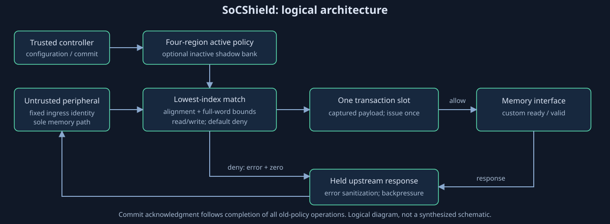
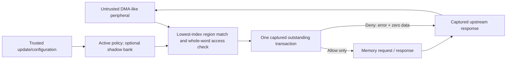
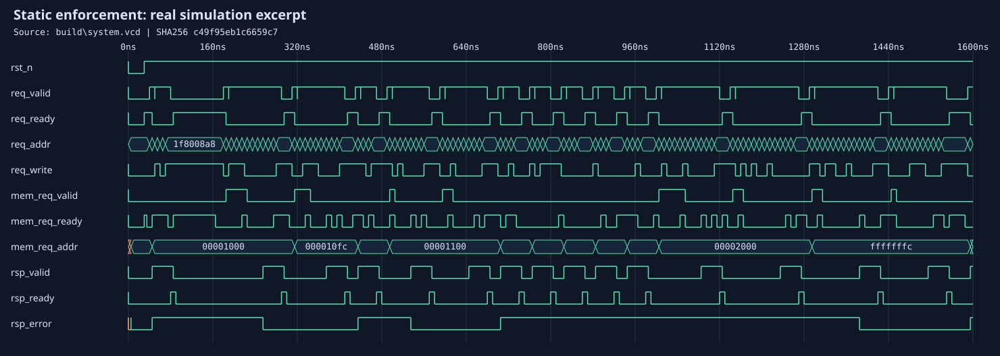
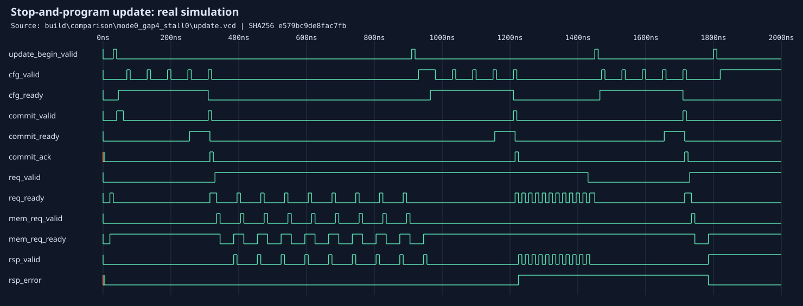
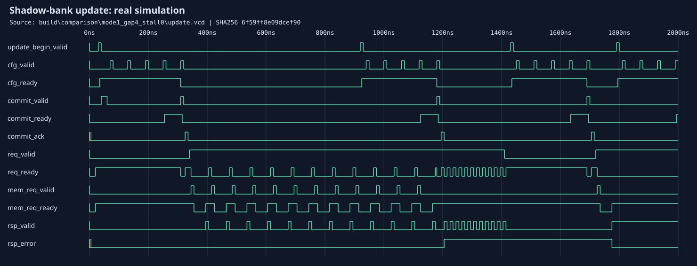

# SoCShield: verified implementation and first comparison

This is the historical standalone baseline. The later RISC-V integration and its current measurements are documented in [the integrated results](integration/results.md). The project repository is now [jrmywm/SoCShield](https://github.com/jrmywm/SoCShield).

2026-10-30. The project lives in `C:\Users\User\Documents\SoCShield`. No GitHub repository has been selected.

## Result

The static firewall and both safe-update variants are implemented. Directed and persistent-memory simulations pass. All three sets of safety assertions pass unbounded temporal induction; separate bounded checks and all cover checks also pass. Four faulty static implementations and an early-drain fault in each update architecture are detected by both simulation and bounded formal checks. An independent parser audited all 13 VCD traces used for the static and update runs.

The measured tradeoff is concrete: a second policy bank adds storage and reduces the time permission programming stops acceptance. It cannot remove interruption caused by a stalled old transaction. This is an implementation study of established access control, with no novelty or silicon-security claim.

## Architecture and contract





Four regions carry inclusive endpoints, enable, and read/write bits. All four bytes of an aligned 32-bit operation must fit inside the selected region. Lower-index matches take priority even when they deny. Default deny and denied writes produce no downstream request. Requester identity is fixed at ingress. The trusted controller is outside the attacker boundary.

The update methods share a stronger completion rule than merely writing permission bits: **commit acknowledgment means every old-policy operation has completed upstream**. Issued writes are not canceled. Stop mode drains before programming one bank. Shadow mode programs an inactive bank during traffic, then drains and atomically switches. Each session writes all four entries before commit, including disabled entries. Full interface, priority, reset, and progress rules are in [the specification](spec.md).

## Measured cost

Both variants use the same parameterized update module and the same synthesis flow. Yosys performs generic synthesis, flattening, and default generic ABC mapping. There is no technology library or timing constraint.

| Synthesis quantity | Stop and program | Shadow bank | Difference |
|---|---:|---:|---:|
| Generic one-bit flip-flop cells | 377 | 648 | +271 (+71.9%) |
| Other generic cells | 2,543 | 2,514 | -29 |
| Total generic cells | 2,920 | 3,162 | +242 (+8.3%) |

These totals are **cell-count area proxies**, not square-micron area or equally weighted gate equivalents. Different generic cells have different physical costs. Optimization can also change combinational mapping, explaining why the non-flop count does not grow monotonically. Library-mapped area, delay, maximum frequency, power, placement, and routing remain unmeasured.

The testbench supplies continuous requests, always consumes responses for the measured interval, and uses a fixed memory-response schedule. Before revocation, both implementations measured **6 cycles from request acceptance to response completion** and a **7-cycle acceptance interval**. Those values depend on this memory model and are not interface guarantees or clock-frequency measurements.

The timing CSV is captured before additional regrant and held-response contract tests. The VCD audit counts the full trace, including those extra tests, so its transaction totals are intentionally larger than the CSV totals.

Every policy writes four complete entries. `GAP` inserts that many additional idle cycles after each entry, including the final entry. Thus larger values represent a slower trusted programmer. The update begins with an outstanding transaction. Timing uses rising-edge samples; acknowledgment is sampled when its registered pulse is high.

With no forced memory stall:

| Additional idle cycles per entry | Stop: acceptance-disabled cycles | Shadow: acceptance-disabled cycles | Stop: maximum gap between accepted requests | Shadow: maximum gap between accepted requests | Shadow: requests accepted while programming/draining |
|---:|---:|---:|---:|---:|---:|
| 0 | 15 | 3 | 17 | 8 | 1 |
| 4 | 31 | 2 | 33 | 9 | 3 |
| 16 | 79 | 2 | 81 | 8 | 10 |

Acceptance-disabled cycles count the update controller's inhibit condition, including time when the transaction slot is occupied. The maximum acceptance gap measures actual service interruption under continuous demand; it also includes the transaction path's ordinary occupancy. These quantities must not be interchanged. Small phase-dependent changes in the shadow result arise from where commit lands relative to the outstanding response.

With a forced 64-cycle memory-acceptance stall around update start:

| Additional idle cycles per entry | Stop: acceptance-disabled cycles | Shadow: acceptance-disabled cycles | Stop: maximum acceptance gap | Shadow: maximum acceptance gap |
|---:|---:|---:|---:|---:|
| 0 | 79 | 60 | 81 | 72 |
| 4 | 95 | 44 | 97 | 72 |
| 16 | 143 | 3 | 145 | 71 |

For slow programming, shadow mode overlaps much of programming with the forced stall. Its controller may inhibit acceptance for only three cycles afterward, while actual traffic still experiences a 71-cycle gap. A permanently stalled request or response can keep commit pending forever. No unbounded stall is converted into a finite guarantee.

## Verification performed

| Check | Static | Stop update | Shadow update |
|---|---|---|---|
| Simulation | Directed + 539 accepted operations, persistent-memory scoreboard | Six measured schedules plus repeated commits and response-stall cases | Same six schedules and contract cases |
| Unbounded safety induction | PASS | PASS | PASS |
| Separate bounded safety check | PASS, 12 cycles | PASS, 24 cycles | PASS, 24 cycles |
| Cover search | PASS, 24-cycle bound | PASS, 32-cycle bound | PASS, 32-cycle bound |
| Deliberate faulty variants | Four faults detected in simulation and bounded formal | Early drain detected in both | Early drain detected in both |

Static cases cover address/region boundaries, all misalignment offsets, priority, inverted/disabled entries, read/write denial, captured payloads, downstream errors, memory and response stalls, changing unaccepted inputs, exact-once accounting, and coordinated reset in all occupied transaction phases. Update simulations also check rejection of incomplete policies, commit/configuration priority, continued shadow traffic, repeated bank reuse, preservation of already-issued writes, and a held upstream response delaying commit. Formal inputs remain arbitrary after an initial reset, with no fairness assumptions. [Verification scope and assumptions](verification.md) state precisely what is proved.

Real trace excerpts, generated from the VCD and labeled with source hashes:







## Reproduce and inspect

From the standalone project directory:

```powershell
.\scripts\verify.ps1
.\scripts\compare.ps1
& .\tools\oss-cad-suite\lib\python3.exe .\scripts\render_evidence.py
```

The pinned tool bundle is OSS CAD Suite 2026-10-29. Static checks are recorded in `build/results.json` and `build/logs/`. Update checks, source hashes, raw synthesis statistics, mutation results, and timing CSV are in `build/comparison/`. `build/waveform_audit.json` records independently reconstructed handshake counts and VCD hashes. Successful proof jobs have a `status` file containing `PASS`, along with base-case and induction logs. Counterexample VCDs belong to deliberately faulty copies, not the real RTL.

This first study is useful as a reproducible portfolio artifact. Broader traffic patterns, multiple randomized seeds, a real cell library, and a larger-system integration would strengthen the evaluation. They are future extensions rather than hidden completion requirements or demonstrated results. There is no physical deployment, power estimate, secure-debug implementation, or claim of a new access-control mechanism.
