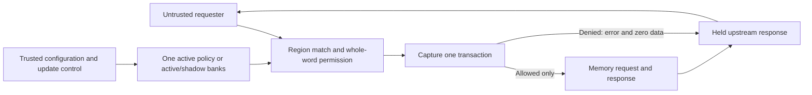

# SoCShield security and interface specification

Revision 1, 2026-10-30. RTL names in this document are normative for this study.

## Security boundary

An untrusted DMA-like peripheral has exactly one path to protected memory, through the firewall. Its identity is trusted and fixed by the ingress wiring. There is no requester-controlled identity field. Configuration and update commands come from a separate trusted controller. The design has one clock and at most one upstream operation outstanding until its response is consumed.

Bursts, caches, virtual memory, alternate access paths, physical attacks, secure debug authentication, and partial writes are outside scope. These exclusions are integration assumptions, not mechanisms enforced by this module.

## Transaction signals

All handshakes are sampled on a rising clock edge with valid and ready high. Addresses are unsigned byte addresses; data is 32 bits. Reads and full-word writes must be aligned to four bytes. Accepted writes have no byte mask. The interface is a documented custom protocol and does not claim AXI compatibility.

| Signals | Meaning |
|---|---|
| `req_valid`, `req_ready` | Upstream request acceptance |
| `req_addr`, `req_write`, `req_wdata` | Address, read/write direction, full write payload |
| `rsp_valid`, `rsp_ready` | Upstream response completion |
| `rsp_error`, `rsp_rdata` | Error indication and read result |
| `mem_req_*`, `mem_rsp_*` | Analogous memory-side request and response |
| `cfg_valid`, `cfg_ready` | Trusted complete-entry write handshake |
| `cfg_index`, `cfg_enable`, `cfg_base`, `cfg_limit`, `cfg_read`, `cfg_write` | Region index 0–3, enable, inclusive endpoints, and permissions |

Firewall request and response outputs hold valid and payload stable under backpressure. Security does not rely on stability of unaccepted requester inputs: the attacker may change any of them while busy. Only values at an acceptance edge are captured. The memory endpoint must produce exactly one response per issued request, hold its response under backpressure, and participate in coordinated reset. No new memory request is issued before the previous upstream response is consumed.

An accepted allowed request is captured, forwarded exactly once, and answered after one downstream response is captured. An accepted denied request returns an error and zero data without asserting any downstream request. A downstream error is propagated with zero upstream data. Successful writes also return zero data.

## Region selection

Find the lowest-index enabled region whose inclusive range contains the first byte address. That region alone controls the request. Then require alignment, the requested permission, and containment of **all four bytes** within that region. An end-of-word check uses 33-bit arithmetic. An insufficient first matching region denies; a later region cannot rescue it. No match denies. Disabled or inverted ranges do not match. The final aligned word at `0xfffffffc` is legal if the selected limit is `0xffffffff`.

## Static configuration

In `firewall.sv`, `cfg_ready` is high only when idle and no request is presented. Thus a presented request wins over simultaneous configuration and uses the existing policy. Configuration writes one entry atomically. Configure after reset before traffic for the static study; this interface alone provides no runtime commit protocol.

## Safe update interface

`firewall_update.sv` adds `update_begin_valid/ready`, `commit_valid/ready`, a one-cycle registered `commit_ack`, and `update_busy`. Every command uses valid/ready acceptance; acknowledgment is sampled when high on a rising edge. Only one update session is open at a time.

Each session must write all four entries, including explicit disabled entries. `commit_ready` remains low until all four indices have been written. Rewriting an index is allowed and the last accepted value wins. A previous shadow-bank value can never substitute for an unwritten entry. Commands presented outside their ready condition have no effect.

| Method | Begin | Programming | Accepted commit | Acknowledgment |
|---|---|---|---|---|
| Stop and program, `SHADOW=0` | Stop acceptance immediately, then drain through upstream response completion | Write the only bank after drain; acceptance stays stopped | Finish session and resume | Registered pulse when the updated policy becomes active |
| Shadow bank, `SHADOW=1` | Open a session while traffic continues | Write the inactive bank while traffic uses the active bank | Stop acceptance immediately and drain | Atomically change active bank, resume, and pulse acknowledgment |

The shared contract is: **when commit acknowledgment is sampled, every operation accepted under the old policy has completed upstream**. Already-issued writes are never retroactively canceled. No policy bank used by an outstanding operation is modified. Revocation affects requests accepted after the switch; it does not erase earlier memory effects.

Simultaneous-event priority is explicit:

1. Reset clears interface state and both policies.
2. A previously started drain advances only when the transaction slot is empty.
3. An accepted commit suppresses both request acceptance and configuration on that edge. A configuration that completes the four-entry mask can enable a commit only on a later edge.
4. Stop-mode begin suppresses request acceptance on the begin edge. Shadow-mode begin can coexist with request acceptance because the active policy is unchanged.
5. During shadow programming, configuration and request acceptance can occur on the same edge and affect different banks. During stop programming, requests remain blocked.

Holding a command valid after acceptance can request a later command when ready is next asserted; controllers should count handshakes. No queue of unaccepted commands exists.

## Reset and progress

`rst_n` is active low. State clearing is synchronous and requires at least one rising edge with reset asserted. Handshake enables are also combinationally suppressed while reset is low. `commit_ack` is a registered signal meaningful only when `rst_n` is high. Firewall and memory-side interface must reset together; pending responses must be discarded. Region enables, update masks, banks, transaction state, and update sessions all reset. The next accepted request defaults to deny until a policy is installed.

Reset abandons outstanding operations and pending commits without acknowledging them. It cannot undo a write already accepted by memory. Memory contents need not reset, but the memory protocol state must flush. The requester must restart its protocol after reset and must not count a reset-abandoned operation as completed.

There is no unconditional finite commit bound. A permanent memory-request stall, missing memory response, or unconsumed upstream response can prevent drain indefinitely. Stop mode also depends on the controller eventually providing four entries and a commit. Shadow mode can prepare a policy during traffic but still depends on drain at commit. Finite service guarantees require explicit bounds for each of these delays. Reported cycle counts use the concrete progress schedule in the comparison testbench.
